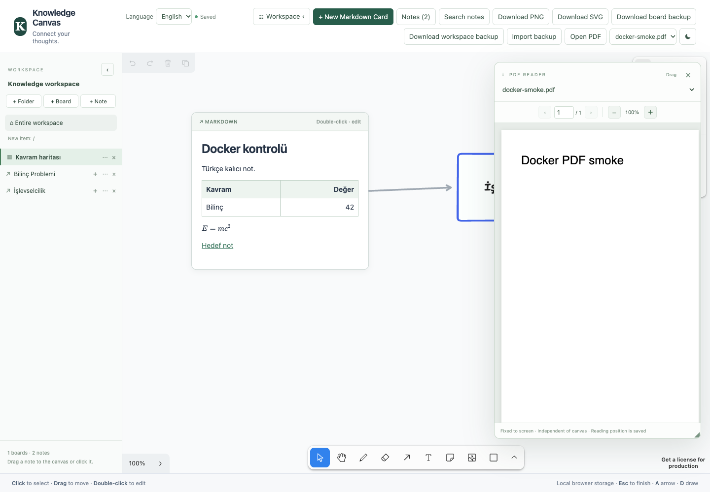
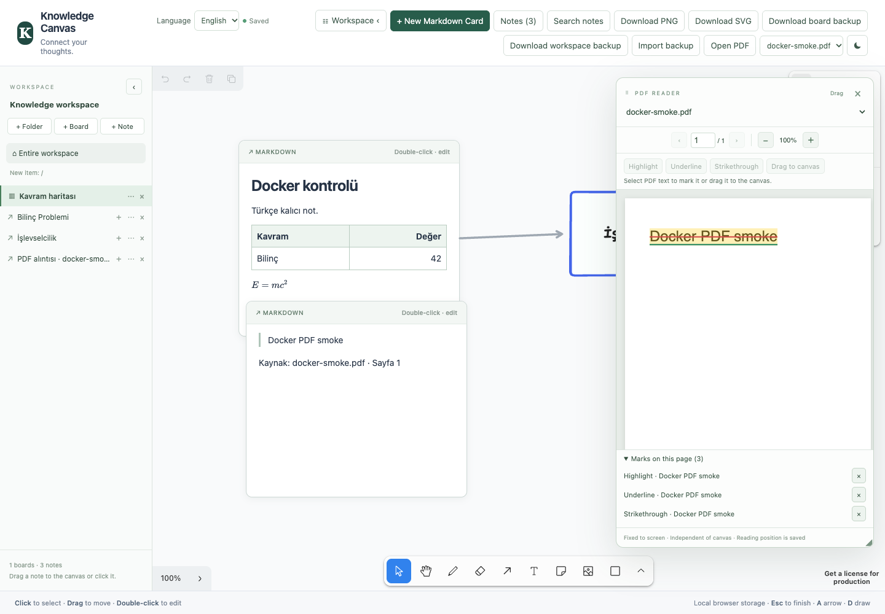

# Knowledge Canvas

Drawings and editable Markdown note cards on an infinite canvas. **The Phase 0–4 development scope has been implemented:** folders, multiple boards, shared notes, autosave/recovery, workspace backups, a movable/resizable PDF panel, and a real filesystem workspace through Tauri. Title/content search, wiki-links/backlinks, Markdown tables, KaTeX, and PNG/SVG export are also available. The user chose to continue in desktop development mode; the standalone license will be decided before packaging.

## Screenshots

The English interface with the workspace explorer, Markdown cards, tables, math, and an independent PDF reading panel:



PDF highlights, underlines, strikethroughs, and an excerpt saved as a separate Markdown card:



These captures use the English interface; existing note names and content remain in their original language.

## Getting started

Node.js 22.13+ is required; development validation used Node 26.8.1 / npm 11.19.0.

```sh
npm ci
npm run dev
```

Open the local address printed by Vite (default: `http://127.0.0.1:5173`). Data is tied to the browser and origin: `localhost`, `127.0.0.1`, and different ports each have separate storage. Use the same address for daily use.

`dev` and `build` copy PDF.js font/CMap/WASM resources from the installed package to `public/pdfjs/`. Vite bundles the worker; the PDF reader does not require an external CDN. Generated `public/pdfjs/` files are excluded from version control.

## Running with Docker

```sh
docker compose up --build -d --wait
```

Open **http://127.0.0.1:8080**. Docker serves the web version; notes/PDFs are stored in the browser, and Tauri's real filesystem workspace is unavailable in this version. Transfer existing data using a workspace JSON backup. For ports, licensing, stopping the app, and HTTPS on a server, see the [Docker guide](docs/docker.md).

## Usage

Select **Türkçe** or **English** from the **Dil / Language** selector in the top menu. The explorer, note editor, PDF panel, confirmation/recovery dialogs, and canvas tools update immediately. Turkish is the default; the preference is remembered for this browser/origin and shared with other tabs on the same origin. Note, folder, and board names and Markdown/PDF content are not translated. The language preference is excluded from workspace JSON backups.

For desktop use, install stable Rust and the macOS Command Line Tools:

```sh
npm run desktop:dev
```

Choose a workspace folder using the system picker; Markdown files are discovered on startup and with “Refresh”. `.md`, `.board.json`, images, and PDFs are real files. External changes require an explicit choice between the disk and local versions; deleted files are kept in a trash folder inside the workspace. Transfer browser data using a workspace JSON backup. See [desktop commands, file formats, and recovery](docs/desktop-workspace.md).

`npm run desktop:build` creates a macOS debug `.app`. The tldraw canvas is disabled in an unlicensed package; use `desktop:dev` for daily development. Support for a valid native license key is configured in `.env.example`. Signed distribution has not been completed.

- Use “+ Folder”, “+ Board”, and “+ Note” in the left explorer. New items are added to the selected folder; “Entire workspace” selects the root. Clicking a folder name selects/opens it; the adjacent arrow expands/collapses it. The “☷ Workspace” button at the top toggles the explorer; `‹` in the panel header also closes it. The preference is remembered in this browser.
- An item's `⋯` button changes its name and destination folder. IDs and shared-note references are preserved. `×` shows the affected content and asks for confirmation before deletion.
- Click a board name to switch boards. Switching saves current changes first; if saving fails, the current board remains open. Deleting a board does not delete shared notes; deleting the last board creates an empty board.
- Drag a note from the explorer onto the canvas, or click its name/`＋` button. You can add the same note to multiple boards; edits are shared across all cards.
- “New Markdown Card” creates a card at the center of the visible area. Click to select, drag to move, and resize from the corners. Double-click the card to edit it; the note name is independent of the Markdown heading.
- “Search notes” or Ctrl/Cmd+K searches titles and content across the entire workspace. Search tolerates Turkish letter and case differences; all entered words must match. Press ↓ to enter the results, ↑/↓ to navigate, and Enter to show the note's card; if it is on another board, the app switches there. A note without a card is added to the current board. The search panel shows the note's wiki-link text and backlinks.
- In source mode, write `[[Note name]]`, `[[Folder/Note name]]`, or `[[Target|Display name]]`; click the link in preview to navigate to the target. If a name is ambiguous, use the folder path; if the same path also has duplicates, use the ID link in the search panel. Renaming or moving a note/folder updates links. A deleted note appears as a broken link and does not reconnect to a new note with the same name. The card's “Backlinks to this note” section shows incoming links.
- In rich-text mode, the table button inserts a 3×2 table. While inside a cell, tools appear for adding/deleting rows and columns and deleting the table. Markdown table alignment and cell formatting are preserved; unsupported complex content stays in source mode.
- `$E=mc^2$` displays inline math; `$$` on separate lines displays block math. KaTeX renders previews with local fonts; notes containing math are edited in source mode.
- “Download PNG” / “Download SVG” export all shapes on the current board and the visible content of cards; the PDF panel is excluded. Desktop opens a native Save As dialog. PNG is raster; browser SVG cards contain HTML, while desktop SVG cards are embedded as images and other shapes remain vectors. Use workspace JSON for a complete, editable data backup.
- Use the Rich text, Source, and Preview tabs. Content that cannot be safely converted to rich text is preserved in source mode; the interface explains why.
- Escape or clicking an empty canvas area ends editing; changes are saved automatically to IndexedDB. The status indicator reports the result; “Retry” is available on failure.
- In dialogs, Tab/Shift+Tab navigate within the dialog; Esc cancels and restores focus. The Markdown mode tabs support left/right arrows and Home/End.
- Text selection, Delete/Backspace, copy/cut/paste, and Ctrl/Cmd+A/Z work in the editor. Outside the editor, undo uses canvas history. The mouse wheel scrolls card content inside the editor; outside it, the SDK's pan/zoom behavior applies.
- Use A for arrows, R for boxes, and D for freehand drawing. The sample arrow stays attached when the card is moved/resized.
- Duplicating a card shares the same note; deleting a card does not delete the note. Saved notes can be added back as cards from the explorer or “Notes” list.
- Before deleting a note, the confirmation dialog shows the boards that use it and the number of affected cards. Cards remain with a “Note not found” message. Deleting a folder also removes its subfolders/boards/notes; affected cards on other boards are listed beforehand.
- PNG/JPEG/WebP/GIF/AVIF images can be dragged/pasted onto the canvas, with a 10 MB limit per file. Image bytes are included in saved data and JSON backups; video is unsupported.
- “Open PDF” copies a local PDF into the workspace (up to 50 MB). Drag the panel's “PDF READER · Drag” header to move it; arrow keys also move it when the header has focus (Shift uses a larger step). The PDF stays fixed on screen while the whiteboard pans/zooms. PDF and whiteboard scrolling/zooming are independent; PDF text can be selected and copied if a text layer is present.
- Drag the PDF panel's edges or bottom-right handle to change its width/height. Arrow keys also resize it when the handle has focus; Shift uses a larger step. Resizing the panel does not change PDF zoom or the whiteboard camera.
- Each board remembers its last PDF, page, zoom, panel position, and size. Closing the panel does not delete the file; reopen it with “Show PDF” or the PDF selector. When the window or workspace panel changes, the PDF panel stays within the visible canvas area.
- Select PDF text and use **Highlight**, **Underline**, or **Strikethrough**. Marks are stored separately in the workspace; the source PDF is unchanged. Boards that open the same PDF share its marks. Click marked PDF text and use **Remove highlight**, **Remove underline**, or **Remove strikethrough**. You can also remove marks with × in the **Marks on this page** list.
- Briefly press and hold selected text, then drag it onto the board, or drag the **Drag to canvas** button. A new Markdown note card appears at the drop location with the PDF name/page as its source; clicking the button also adds a card at the center of the visible area. The excerpt is an independent note; existing cards and PDF text are unchanged. Scanned PDFs without a text layer do not support selection/OCR.
- “Download workspace backup” includes all folders, boards, shared/saved notes, images, PDF bytes/annotations, and board-specific reading positions. **Use this for a complete backup.**
- “Download board backup” exports only the current board, all notes, and that board's images in the legacy Phase 1 format; it excludes other boards, folders, and PDFs. The card editor's `.md` download exports one note as UTF-8 Markdown.
- “Import backup” validates a workspace or legacy single-board backup, then asks for confirmation to **replace the entire current workspace**. Explicit replacement also applies to ID conflicts; there is no automatic merge. Canceling or selecting an invalid file leaves existing data unchanged. Importing a legacy board backup creates a workspace with one board.
- The theme is remembered in the same browser. A second tab opens read-only and allows navigation between boards. After closing the editing tab, reload the other tab to enable editing.

Saves use an approximately 600 ms debounce, with draft checkpoints at approximately 80 ms intervals. If a newer draft is found on reopening, the app offers recovery; corrupt or unsupported saved data is not silently reset. You can still download a backup of the current workspace in memory while a save error persists. An abrupt process exit may lose the last unfinished write; clearing browser/site data deletes saved data. Make regular workspace backups.

IndexedDB storage and logical folders in the browser version differ from real filesystem access. The desktop version works with real files in the selected workspace; external changes are loaded with “Refresh”, and there is no watcher.

## Validation commands

```sh
npm run typecheck
npm test
npm run build
npm run test:e2e
npm run desktop:test
```

Full web validation of the PDF text tools on October 9, 2026: **56 unit tests, 52 Chrome scenarios, typecheck, and the Docker production build passed.** PDF annotations/excerpts, both languages, saving/backups, and read-only checks passed; annotations and the excerpt card persisted in production Chrome after recreating the container. The full test run and the language-independent selector fix for the visual test are recorded in the [progress log](docs/progress.md). Earlier Phase 4 validation also passed **12 Rust filesystem tests and a native build**; native Rust/WebKit checks were not rerun for this frontend addition, but the shared filesystem codec was tested. Chrome Phase 3 tests mock native IPC; an earlier real Tauri smoke test was run separately.

E2E tests require **Google Chrome** installed on the system and port `127.0.0.1:4173` available. Playwright starts and stops the Vite server in test mode. Screenshots/traces are stored in the temporary `test-results/` directory. Building does not publish the app or provide a production license.

The addition of direct mark removal on PDFs also passed **14 relevant Chrome tests**, typecheck, and the Docker production build. The new test verifies separate removal of all three mark types, persistence of removal after reload, and native text selection.

## Scope and limitations

- Rich-text mode supports headings/paragraphs, bold/italic, ordered/unordered and nested lists, links, quotes, fenced/inline code, Unicode, and GFM tables. Task lists, HTML/comments, wiki-links, footnotes, math, frontmatter, and images within Markdown are preserved in source mode. See the detailed [support matrix](docs/progress.md).
- Preview does not execute HTML and filters unsafe URLs; it shows placeholders instead of downloading remote Markdown images. Canvas images are independent assets.
- Only the active card has a Tiptap instance. Native source undo and Tiptap rich-text history are separate sessions; switching mode/editor resets history while preserving content. Switching boards also resets canvas history.
- Persistent storage/full backups use `knowledge-canvas-workspace` v1; legacy `knowledge-canvas-board` v1 can be imported. On first launch, legacy IndexedDB board data is migrated with IDs/content preserved. Camera, selection, undo, and theme are excluded from backups.
- Markdown file discovery and real filesystem access are available on desktop; browser file import and a watcher are unavailable. Browser SVG requires a viewer supporting HTML `foreignObject`; desktop cards are embedded in SVG as 2× raster images. Long notes are clipped to the card's visible area. PDFs use their existing text layer; there is no OCR/password interface. Encrypted or unreadable PDFs show an error while preserving notes/boards. Backup imports are limited to 100 MB.
- Read-only tabs do not sync live; reload to see updates. PDF navigation in those tabs lasts only for the session. Without Web Locks, safe editing is disabled.
- PDF.js resources are local; the SDK's default font/icon resources may use a CDN. Fully offline operation has not been verified. Notes and PDFs do not use a server/account.
- The main JS bundle is approximately 2.61 MB (785 KB gzip); the separate PDF engine is 430 KB (130 KB gzip), the worker is 1.26 MB, and local PDF resources total 4.3 MB. Vite reports a large-chunk warning. Encoding the entire workspace snapshot is costly with large PDFs/many boards; measurements for 100 cards + 200 shapes and their limits are in the [performance record](docs/phase4-performance.json).
- Chrome and macOS Tauri development smoke tests passed; IME coverage is limited to CDP composition/commit. Physical OS IME, mobile, Linux/Windows desktop, and Safari/Firefox have not been validated. Native WebKit coverage includes basic note/PDF smoke tests; the full Chrome suite was not run in native WebKit.

## Packages and licensing

As of October 8, 2026: React 19.3.0, tldraw 5.5.2, Tiptap 3.31.4, react-markdown 10.1.0, marked 17.0.4, pdfjs-dist 6.4.299, KaTeX 0.19.0, remark-gfm 4.0.1, remark-math 6.0.0, rehype-katex 7.0.1, Vite 8.3.4, TypeScript 7.0.2, Vitest 5.0.3, Playwright 1.64.0; IndexedDB tests use fake-indexeddb 6.2.5. Versions are pinned in package.json and package-lock.json.

According to the [tldraw licensing explanation](https://tldraw.dev/community/license), the default terms cover development use. Production requires an appropriate, valid trial/commercial/hobby license and key. Personal use is not an automatic exemption. License checks/SDK branding have not been removed; the app has not been published.

The Tiptap packages used are [MIT-licensed](https://github.com/ueberdosis/tiptap/blob/main/LICENSE.md); no paid cloud conversion service is used. [Markdown support](https://tiptap.dev/docs/editor/markdown) is in beta; lossless conversion is not guaranteed for every syntax.

The PDF reader uses Mozilla's [PDF.js API](https://mozilla.github.io/pdf.js/examples/). pdfjs-dist and the adapted text-layer CSS are [Apache-2.0-licensed](https://github.com/mozilla/pdf.js/blob/master/LICENSE); the worker/font/CMap/WASM resources come from the same pinned package version.

## Project documentation

- [Phase plan](knowledge_canvas_faz_plani.md)
- [Requirements](knowledge_canvas_vibecoding_prompt.md)
- [Progress and validation evidence](docs/progress.md)
- [Decisions](docs/decisions.md)
- [Implemented architecture](docs/architecture.md)
- [Desktop workspace and recovery](docs/desktop-workspace.md)
- [Running with Docker](docs/docker.md)
- [Initial review](docs/review.md)
